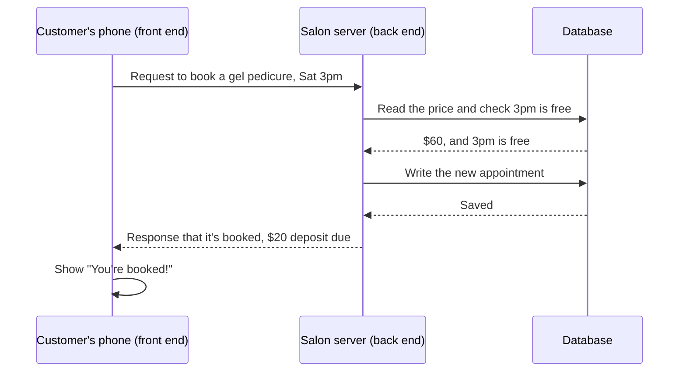

Lesson 1, Part 1 of 5 · about 10 min

# Front end and back end

**In this part,** you'll see what the front end and back end each do, why the back end gets the final say, and what happens when a customer taps **Book** in the Polish & Co. assistant.

**Quick check before you start.** If you can answer both of these, skip ahead to the "Go deeper" sections.
1. The booking screen shows a price. Where should the price the customer actually pays come from?
2. What's the difference between a request and a response?

## Why this matters

You'll hear "is that a front-end change or a back-end change?" almost every week as a PM. The answer changes:
- who builds it
- how long it takes
- how risky it is to ship
- where to look when it breaks

Knowing where a rule lives also tells you whether someone can get around it. That matters a lot once AI is involved, and it comes back in [Prompt injection](../10-prompt-injection/).

## How it works

Most software is split into two halves that talk to each other. MDN, the reference most web developers use, puts it like this:

> "Web servers wait for client request messages, process them when they arrive, and reply to the web browser with an HTTP response message."
> [MDN, Client-server overview](https://developer.mozilla.org/en-US/docs/Learn_web_development/Extensions/Server-side/First_steps/Client-Server_overview)

The **client** is the front end. The **server** is the back end.

| | Front end (client) | Back end (server) |
|---|---|---|
| **Where it runs** | On the customer's phone or in their browser | On computers the business controls |
| **Its job** | Show things and collect what the customer types or taps | Decide things and remember them |
| **Who can mess with it** | Anyone holding the phone | Only the team, if it's set up properly |
| **At Polish & Co.** | The chat bubble, the time options, the **Book** button | The price list, the deposit rule, checking the time is free, saving the booking |

The row that matters most is "who can mess with it". The front end runs on the customer's device, so a curious customer can change what it sends. That's why anything important gets decided on the back end. The front end can *show* the price. The back end *decides* the price.

### 1. Spot the two halves

**Sort each piece of the salon assistant into front end or back end.** Look at this list and decide for each one before you open the answer:
1. The chat window and its bubbles
2. The **Book** button
3. Checking the gel pedicure is $60
4. Checking whether a $20 deposit is needed
5. Checking Saturday at 3pm is still free
6. Saving the appointment
7. The "You're booked!" message on screen

Answers

- **Front end:** 1, 2 and 7. They're things the customer sees and taps.
- **Back end:** 3, 4, 5 and 6. They're rules and records. If any of them lived only on the phone, a customer could change them.

### 2. Follow one tap

**Follow what happens after the customer taps Book.** Say a customer types "Can I get a gel pedicure on Saturday at 3?" The assistant offers Saturday, November 14 at 3pm with a **Book** button, and she taps it. Here's the trip:
1. **The front end packs up the details.** Which service, which time, her name and phone number. That bundle is called a **request**.
2. **The request travels to the back end.** It goes over the internet to an address the salon's back end listens on, like `https://api.polishandco.example/api/bookings`.
3. **The back end checks the rules.** It looks up the real price ($60), checks 3pm is still free, and works out that a $20 deposit is needed because the appointment is over $50.
4. **The back end writes to the database.** It adds a new row to the appointments table. Now it's really booked.
5. **The back end sends a response.** "Booked. Gel pedicure, Saturday at 3pm, $20 deposit due."
6. **The front end shows the result.** "You're booked for Saturday at 3pm!"

That whole trip usually takes well under a second. You'll read the actual request and response in [Part 2](part-2-apis-json-and-status-codes.md), and be the database yourself in [Part 3](part-3-databases.md).

<strong>Stuck?</strong>

- **"Where's the AI in this?"** The AI model doing the chatting is one more service the back end calls, a lot like the database. You'll see how in [Lesson 2](../02-how-llms-and-agents-work/). Notice that the booking itself doesn't need the AI at all. Plain code checks the price and the time, every time, the same way.
- **"Why not let the phone check if 3pm is free?"** Because the phone only knows what it last saw. Another customer could have booked 3pm a second ago. The database is the only place that knows right now.

<strong>Go deeper (what a server actually is, and where the front end comes from)</strong>

- **A server is just a computer** that's always on and listening for requests. Today it's usually rented from a cloud provider. "Serverless" still runs on servers. It means the provider starts your code when a request comes in, so your team doesn't manage the machines.
- **The front end comes from a server too.** A website's front end is HTML, CSS and JavaScript files the browser downloads, then runs on your device. A phone app's front end is installed from the app store. Either way, once it's on the device, it's out of your hands.
- **Static vs dynamic.** MDN describes a static site as one that "returns the same hardcoded content from the server whenever a particular resource is requested", and a dynamic site as one that "can generate and return content based on the specific request URL and data". The salon's FAQ page could be static. Booking has to be dynamic, because the answer depends on the database.
- **Never trust the client.** Engineers say this a lot. It means the back end re-checks everything the front end sends, even if the front end already checked it. Front-end checks are for a nice experience. Back-end checks are for the rules.

## Quick check

1. Why does the back end look up the price itself instead of using the price the phone sends?

The front end runs on the customer's device, so it can be changed. The back end is the only place the salon controls, so that's where the real price lives.

2. At which step is the appointment actually booked?

Step 4, when the back end writes the new row to the database. Until then, nothing is saved.

---

**Next: [Part 2 (APIs, JSON and status codes)](part-2-apis-json-and-status-codes.md)** | [Back to the lesson](README.md)
