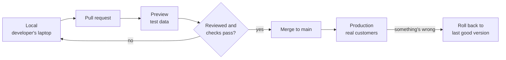

Lesson 1, Part 4 of 5 · about 10 min

# Where code lives

**In this part,** you'll see where the salon's code lives, the three places it runs, and what actually happens when someone says "we're deploying".

## Why this matters

These are the sentences you'll hear in stand-ups and release planning:
- "It works on my machine."
- "It's on staging, can you check it?"
- "We're deploying Thursday."
- "Roll it back."

Each one is about where code is and how it moves. Once you know the map, you can ask the right question when a release goes sideways, and you'll know which changes are easy to undo and which aren't.

## How it works

Three different things live in three different places. Mixing them up causes a lot of confusion.

| Thing | Where it lives | At the salon |
|---|---|---|
| **Code** | A **repository** (repo), usually on GitHub | The booking screen, the deposit rule, the endpoint |
| **Data** | The **database** | Every appointment and every price |
| **Secrets** | **Environment settings**, never the repo | The password to the database, the key for the AI model |

A **repo** is a folder of code plus the full history of every change ever made to it. You made a change to a repo in [Your first pull request](../03-your-first-pull-request/), and you'll see why that history matters in [Why PRs matter for a PM](../04-why-prs-matter-for-pms/). GitHub's [About repositories](https://docs.github.com/en/repositories/creating-and-managing-repositories/about-repositories) page has the official version.

The same code runs in more than one place. Each place is called an **environment**, and each one usually has its own database and its own secrets. Vercel, a popular hosting platform, describes three default environments ([Vercel, Environments](https://vercel.com/docs/deployments/environments)):

| Environment | Who uses it | Data | At the salon |
|---|---|---|---|
| **Local** | One developer, on their own laptop | Fake | Trying a new deposit message |
| **Preview or staging** | The team and testers | Test data | Clicking through the new flow before customers see it |
| **Production** | Real customers | Real | Saturday's actual bookings |

Vercel describes preview environments as a way "to deploy and test changes in a live setting, without affecting your production site." Staging is the older name for the same idea. Some teams have one long-lived staging site, and others get a fresh preview link for every pull request.

A **deploy** is taking one version of the code from the repo, building it, putting it on the servers for an environment and switching it on. A **rollback** is switching back to the last version that worked.

### 10. Trace a change from idea to customers

**Follow one change all the way to production.** Say the salon wants the **Book** button to show the deposit, like "Book (deposit $20)". Here's the usual trip:
1. **A developer makes the change locally**, on a branch, and tries it on their laptop.
2. **They open a pull request.** The team can see exactly what changed.
3. **A preview deploy goes up.** The PR gets a link where anyone can click through the new button.
4. **Someone reviews and checks the preview.** Tests and evals run here too.
5. **The PR is merged into `main`.** On many setups, Vercel's included, merging to the main branch triggers a production deploy automatically.
6. **Check it in production.** Book a test appointment and make sure the button and the row in the database both look right.
7. **Roll back if it's wrong.** Switch production back to the previous version.

### 11. Ask four questions about any release

**Use these four questions whenever someone tells you something shipped.**
1. **Which environment is it in right now?** "Done" on staging isn't done for customers.
2. **Which halves does it touch?** Front end, back end, database, or more than one.
3. **Does it change data?** If it does, rollback gets harder. You can switch the code back in a minute, but bookings that buggy code already wrote stay written.
4. **How will we know it worked in production?** The screen saying "booked" is one check. The row in the database is the second.

That third question is the one that catches teams out. A code rollback is quick. A data cleanup can take days.

<strong>Stuck?</strong>

- **"Why not test on production? It's the real thing."** Because the real thing has real customers. A test booking on production takes a real slot from a real customer, and a bug there can charge someone's card.
- **"Then why does it ever break in production if it worked on staging?"** Staging is never a perfect copy. The data is different, the traffic is lower, and some settings differ. That's why step 6 exists.

<strong>Go deeper (keeping environments alike, feature flags and migrations)</strong>

- **Keep environments as alike as you can.** The Twelve-Factor App, a widely cited set of rules for building web apps, says: "Keep development, staging, and production as similar as possible" ([Twelve-Factor, Dev/prod parity](https://12factor.net/dev-prod-parity)). Every difference between staging and production is a place a bug can hide.
- **Secrets differ on purpose.** Staging should use a test payment key so nobody's card gets charged. That's why secrets live in environment settings and not in the code.
- **Feature flags** let a team deploy code that's switched off, then turn it on for some customers later, without another deploy. It splits "deployed" from "released".
- **Database migrations** are changes to the shape of a table, like adding a `deposit` column. They run once per environment and they're harder to undo than code. Teams often split risky ones into steps: add the new column, start using it, then remove the old one later.

## Quick check

1. Code, data and secrets. Which one goes in the repo?

Only code. Data lives in the database, and secrets live in environment settings.

2. A release went out with a bug that saved wrong deposits for an hour. You roll back. Is everything fixed?

No. The code is fixed, but the bookings saved during that hour still have wrong deposits in the database. Someone has to find and correct those rows.

---

**Next: [Part 5 (Wrap up)](part-5-wrap-up.md)** | [Back to the lesson](README.md)
