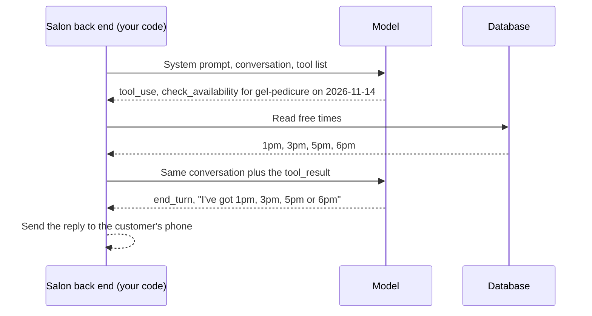
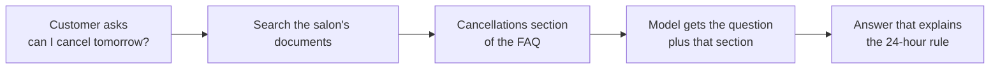

<sub>Lesson 2, Part 3 of 5 · about 15 min</sub>

# Tools, agents and RAG

**In this part,** you'll give the salon assistant a tool, follow one booking request through the agent loop, decide when something counts as an agent, and see how RAG looks up the right part of the FAQ.

## Why this matters

On its own, a model can only write text. It can't check the appointment book, book anything or send a text message. Tools are how it gets to do those things, and they're also where the real risk comes in.

As a PM you'll be the one deciding:
- which tools the assistant gets
- which actions need a person to approve them
- whether you need an agent at all, or something simpler

## How it works

### 7. Give the model a tool

**Describe a tool the model is allowed to ask for.** A tool is a name, a description in plain words, and the inputs it needs. Here's one for the salon, in the format Anthropic's API uses:

```json
{
  "name": "check_availability",
  "description": "Look up free start times at Polish & Co. for one service on one date. Use this before offering any time to a customer.",
  "input_schema": {
    "type": "object",
    "properties": {
      "service_id": { "type": "string", "description": "For example gel-pedicure" },
      "date": { "type": "string", "description": "The date as YYYY-MM-DD" }
    },
    "required": ["service_id", "date"]
  }
}
```

This goes into the request alongside the system prompt and messages. Anthropic's [tool use overview](https://platform.claude.com/docs/en/agents-and-tools/tool-use/overview) explains what happens next:

> "Claude determines when to call a tool based on the user's request and the tool's description. It then returns a structured call that your application runs."

That last part is the important bit. The model never touches the database. It asks, and your code decides whether to do it and how. Some people call this function calling. It's the same idea.

### 8. Follow one booking through the loop

**Trace what happens when a customer asks for a time.** She types "Can I get a gel pedi Saturday afternoon?"
1. **The back end sends the request.** System prompt, the conversation, and the `check_availability` tool.
2. **The model asks for the tool.** Instead of a normal reply, it comes back with `stop_reason: "tool_use"` and a block that says, in effect, "run `check_availability` with `gel-pedicure` and `2026-11-14`".
3. **Your code runs it.** This is a database read, exactly like you did by hand in [Lesson 1, Part 3](../01-how-software-works/part-3-databases.md). It finds the free start times on the hour from 1pm on: 1pm, 3pm, 5pm and 6pm.
4. **Your code sends the result back.** A new request with the whole conversation, the model's tool call, and a `tool_result` holding those four times.
5. **The model writes the reply.** "Saturday afternoon I've got 1pm, 3pm, 5pm or 6pm. Which works for you?" This time `stop_reason` is `end_turn`.



Every arrow between the back end and the model is a full API request with the whole folder, because the API is stateless. And the loop lives in your code. Your code decides whether to run the tool, what to do if it fails, and when to stop.

<details>
<summary><strong>Stuck?</strong></summary>

- **"Does the model run the code?"** Not for tools like this one. Anthropic calls these client tools: they "run in your application". Some providers also offer tools they run themselves, like web search, but even then the model only asks.
- **"What if it asks for a tool with the wrong inputs?"** Your code should check, the same way the back end re-checks everything the phone sends. A date of `2026-11-16` is a Monday, so the honest answer is "closed".
</details>

### 9. Decide what makes it an agent

**Use the tool loop to sort chatbots, workflows and agents.** Simon Willison, a developer who writes a lot about AI, offers a definition many people now share:

> "An LLM agent runs tools in a loop to achieve a goal."
> [Simon Willison, I think "agent" may finally have a widely enough agreed upon definition to be useful jargon now (2025)](https://simonwillison.net/2025/Sep/18/agents/)

Anthropic draws a useful line between workflows and agents. "Workflows are systems where LLMs and tools are orchestrated through predefined code paths", while agents are "LLMs using tools based on environmental feedback in a loop" ([Building effective agents](https://www.anthropic.com/engineering/building-effective-agents)).

Here's what each would look like at Polish & Co.:

| | What it does | Who decides the steps |
|---|---|---|
| **Chatbot** | Answers questions from the FAQ. One request, one reply, no tools. | Nobody. There's only one step. |
| **Workflow** | Your code runs fixed steps: check for must-escalate words, hand off if found, otherwise look up the FAQ and have the model write a reply. | You, in code. You can draw the flowchart. |
| **Agent** | The model has `check_availability`, `create_booking` and `hand_off` tools, and keeps choosing which one to call next until the booking's done. | The model, at runtime. |

Anthropic's advice is to start with "the simplest solution possible, and only increasing complexity when needed", and it adds that this "might mean not building agentic systems at all."

My rule of thumb is that if you can draw the flowchart, build the workflow. You can test every path in a workflow because you wrote every path. In an agent, the model picks the path while it runs, so there are paths you've never seen. That's fine for "find me a time that works". It's not fine for "this customer says her lips are swelling", which is why the handoff in [Evals 101](../06-evals-101/) is treated as a must pass, and why [When AI mistakes are expensive](../13-when-ai-mistakes-are-expensive/) keeps decisions like that in code.

### 10. Look up the FAQ (RAG)

**See how the model answers from documents it was never trained on.** The model doesn't know the salon's documents. You hand it the right part a second before it answers. That's **RAG**, short for retrieval augmented generation. Anthropic's glossary describes it as passing "an external knowledge base or a set of documents" into the context window at the moment a question comes in ([Claude glossary](https://platform.claude.com/docs/en/about-claude/glossary)).

The steps:
1. **Retrieve.** Search your documents for the parts most related to the question.
2. **Augment.** Put those parts into the request, usually in the system prompt or inside tags.
3. **Generate.** The model writes the answer from what you gave it.



The Polish & Co. FAQ is short enough to paste in whole every time, which is what Evals 101 does. RAG starts to matter when the salon has far more than fits comfortably, like every product sheet, the staff handbook and years of policy updates. Then you only send the parts that matter, which keeps the folder small and avoids the context rot you read about in Part 2.

Two things can go wrong, and they're fixed in opposite ways:
1. **Retrieval found the wrong part.** The model answered the lateness question with the cancellations section. Fix the search.
2. **The answer got the right part wrong.** It had the cancellations section and still said "full refund". Fix the prompt or the model.

So test them separately. "Did it find the right section?" and "did it answer correctly from it?" are two different checks.

<details>
<summary><strong>Go deeper (how retrieval works, and where it trips up)</strong></summary>

- **Keyword search or meaning search.** Retrieval can look for matching words, or use **embeddings**, which turn text into numbers so that "can I bring my kid" lands near the kids' manicure section even with no shared words. Many systems use both.
- **Chunking.** Documents are split into pieces before they're searched. Split on the natural unit, like one FAQ section or one whole email thread, not every 500 characters, or the answer gets cut in half.
- **Context helps retrieval.** Anthropic's [Contextual retrieval](https://www.anthropic.com/engineering/contextual-retrieval) post shows how adding a short note to each chunk, explaining where it sits in the whole document, helps search find the right one.
- **Retrieved text is untrusted.** Anything you retrieve gets read as part of the folder. If a document contains instructions, the model may follow them. That's indirect [prompt injection](../10-prompt-injection/).
- **Where the name comes from.** The term was coined in [Lewis et al. (2020)](https://arxiv.org/abs/2005.11401), which combined a search step with a text generator.
</details>

## Quick check

<details>
<summary>1. When the model "calls a tool", who actually runs it?</summary>

Your code, for tools you define. The model returns a structured request, and your application decides whether to run it, runs it, and sends back the result.
</details>

<details>
<summary>2. What turns a model with tools into an agent?</summary>

The loop. An agent keeps calling tools, reading the results and deciding what to do next until the goal is done. A single tool call followed by an answer is closer to a workflow step.
</details>

<details>
<summary>3. The assistant gave the wrong cancellation answer. What two things would you check?</summary>

Whether retrieval found the cancellations section at all, and whether the model answered correctly from it. They're separate problems with separate fixes.
</details>

---

**Next: [Part 4 (Three distinctions)](part-4-three-distinctions.md)** | [Back to the lesson](README.md)
