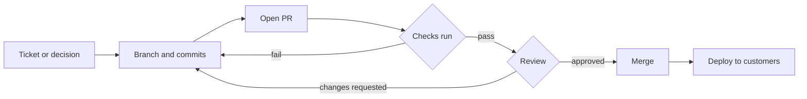

Lesson 4, Part 1 of 5 · about 10 min

# Where decisions actually get made

**In this part,** you'll see why the PR is where product decisions really land, and learn the five places on a PR page that tell a PM what they need to know.

**Quick check before you start.** If you can answer both of these, skim this part and jump to [Part 2](part-2-read-a-pr.md).
1. A PR's checks are all green. Does that mean the change is right?
2. Where on a PR page would you look to see whether the change does more than the description says?

## Why this matters

Here's what happens if you never open the PRs on your product. The ticket says "update the cancellation policy". Somewhere between that ticket and the customer, someone picks the actual number, writes the actual sentence and decides what happens to people who already booked. That someone is whoever wrote the PR. If nobody with product context reads it, those product calls get made without you.

So the PR matters to a PM for four reasons:
1. **It's where the details get settled.** Tickets describe intent. The PR holds the exact change, and the review is the last cheap moment to say "that's not what I meant".
2. **It's the record.** Six months later, someone asks why the cancellation window is 48 hours. The PR has the change, the reason, the discussion and who approved it, all on one page. A Slack thread doesn't.
3. **It's where AI agents hand work back.** Coding agents like Claude Code usually finish by opening a PR, or by leaving changes you turn into one. Reviewing that PR is how you supervise the agent. You'll do this yourself in [Lesson 5](../05-build-with-an-ai-agent/).
4. **It's evidence of what you shipped.** Builder roles increasingly look at PRs as proof of work. A history of small, clear PRs answers "what did you ship?" with links.

## How it works

Every PR page on GitHub has the same five parts. You met them in Lesson 3 as the author. This time, look at them as the person deciding whether the change should go out.

| Where | What it tells you | The PM question |
|---|---|---|
| **Title** | What the change does, in one line | Can I tell what this delivers without opening it? |
| **Description** | Why it's happening, how it was checked, what's left out | Is the reason real, and is it linked to a ticket or decision? |
| **Files changed** (the diff) | Exactly which lines were added and removed | Does the change match the description, and nothing more? |
| **Checks** | Automated tests and evals that ran on the change | Did the right checks run, and did they pass? |
| **Conversation** | Comments, reviews and approvals | Are the open questions answered? Who said yes? |

The trick is that you don't need to understand every line to use these. You're checking that the five parts tell the same story. When they don't, that's where the problem usually is.

<strong>Go deeper (merging isn't always shipping)</strong>

On a lot of teams, merging a PR and customers seeing the change are two different moments.
- **Deploys.** Some teams deploy every merge to production automatically. Others batch merges into a release that goes out later. Ask your team which one you have, because it changes how careful the review needs to be.
- **Preview links.** Many hosting tools build a preview of the site for every PR. If your team has them, the preview link is the fastest way for a PM to check a change. Click it before you read anything else.
- **Feature flags.** A change can merge "off" and get turned on later for some customers. Then the PR isn't the moment of release. The flag change is. Ask where flag changes get reviewed.
- **Branch protection.** A repo can require passing checks and an approving review before anything merges into `main`. If yours doesn't, a PR can merge with nobody looking at it.

<strong>Go deeper (green checks don't mean right)</strong>

A check only knows what someone told it to test. Green means "nothing we test for broke". It doesn't mean:
- the change matches what the customer needs
- the copy is right
- the edge cases you care about are covered
- the checks you expected actually ran (workflows can be set to skip some files)

That gap is the PM's part of the review. GitHub's own docs describe status checks as showing whether a commit meets the conditions a repository has set, usually from tests, builds or deployments ([GitHub Docs, Status checks](https://docs.github.com/en/pull-requests/collaborating-with-pull-requests/collaborating-on-repositories-with-code-quality-features/about-status-checks)). A check is only as good as its conditions.

## Quick check

1. Name the five places on a PR page a PM should look.

The title, the description, Files changed (the diff), the checks, and the conversation.

2. Why is the PR a better record of a decision than a Slack thread?

It holds the exact change, the reason, the discussion and who approved it on one page, attached to the change itself. A Slack thread has the talk but not the change, and it's hard to find later.

---

**Next: [Part 2 (Read a PR like a PM)](part-2-read-a-pr.md)** | [Back to the lesson](README.md)
