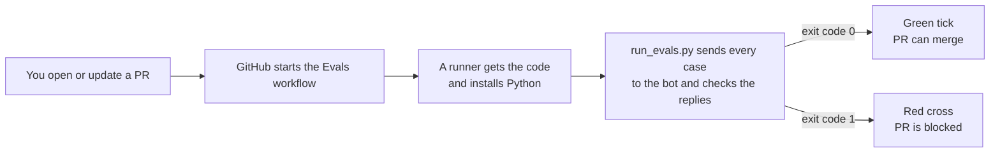

<sub>Lesson 9, Part 1 of 5 · about 10 min</sub>

# What CI is

**In this part,** you'll learn what CI means in plain words, the five GitHub Actions terms you'll keep seeing, and set up the folder your evals will live in.

**Quick check before you start.** If you can answer these, skip ahead to Part 2.
1. What makes a check on a pull request go red?
2. Where does a GitHub Actions workflow file live in a repo?

## Why this matters

Up to now, you've run the golden set by hand. That works when you remember. The trouble is the moments you don't remember are the risky ones: the quick prompt tweak on a Friday, the model upgrade someone else made, the FAQ edit that "couldn't possibly" affect the handoff.

**CI**, short for continuous integration, means every change gets checked automatically before it joins the main version of the project. Nobody has to remember. The check runs on every pull request, and the result sits right on the PR for everyone to see.

For a PM, this changes three things:
1. **"Done" gets enforced.** Your pass bar from Evals 101 stops being a document and becomes a rule GitHub enforces.
2. **The PR carries the proof.** Anyone reviewing a change can see the eval result without asking.
3. **Safety cases can't be skipped.** If ME-07 fails, the change doesn't merge. Nobody has to win an argument about it.

## How it works

GitHub's own tool for CI is called GitHub Actions. Here are the five words you'll see, in GitHub's words ([Understanding GitHub Actions](https://docs.github.com/en/actions/get-started/understand-github-actions)):

| Word | GitHub's definition | In this lesson |
|---|---|---|
| **Workflow** | "A configurable automated process that will run one or more jobs." | `evals.yml`, the file that says "run the golden set" |
| **Event** | "A specific activity in a repository that triggers a workflow run." | Someone opens or updates a pull request |
| **Job** | "A set of steps in a workflow that is executed on the same runner." | `golden-set`, our one job |
| **Step** | "Either a shell script that will be executed, or an action that will be run." | Get the code, set up Python, install, run the script |
| **Runner** | "A server that runs your workflows when they're triggered." | A fresh Linux machine GitHub lends you for the run |

The part that makes the check go red or green is simple. When a script finishes, it hands back a number called an **exit code**. Zero means "everything's fine". Anything else means "something failed". GitHub reads that number. That's why the eval script you'll use in Part 2 exits with 1 when a must-pass case fails.



## Do it (step by step)

### 1. Plan where the files go

**Everything for the evals lives in one `evals/` folder, and the workflow lives where GitHub looks for it.** GitHub only finds workflow files inside `.github/workflows/` at the top of your repo. The dot at the start of `.github` matters.

```text
your-repo/
  .github/
    workflows/
      evals.yml          the workflow (from this lesson)
  evals/
    run_evals.py         the eval script
    golden-set.csv       Lesson 7's salon-golden-set-v2.csv, renamed
    bot-prompt.txt       the booking assistant's instructions
    baseline.json        the score to compare against
    requirements.txt     the Python package the script needs
```

Keeping the bot's prompt in the repo matters. When someone changes the prompt, that change is a pull request, and the pull request runs the evals against the new prompt. That's the whole loop.

### 2. Add the eval files on a branch

**Create a branch and add the five files in the `evals/` folder.** In your repo on GitHub, use **Add file**, then **Create new file**. Typing a slash in the file name makes a folder, so typing `evals/run_evals.py` creates the folder and the file at once. Paste in the contents of each file from this lesson. Rename the golden set to `golden-set.csv`.

Leave the workflow file for Part 3. You'll want to read the script first.

**You're done when** your branch has an `evals/` folder with all five files in it.

<details>
<summary><strong>Stuck?</strong></summary>

- **"I don't have a repo for the bot."** Make a new private repo just for this lesson. It only needs the `evals/` folder and the workflow.
- **"Where's the bot's actual code?"** For this lesson, the bot is just the prompt plus a model. The script calls the model with the prompt, the same way your app would. If your real app does more (looks things up, calls tools), the script should call your app's code instead.
- **"Do I need the terminal?"** Not for this part. Part 2 has an optional terminal step, and Part 3 is all in the browser.
</details>

<details>
<summary><strong>Go deeper (CI, CD, and why each run starts fresh)</strong></summary>

**CI and CD.** CI (continuous integration) is checking every change before it merges. CD (continuous delivery or deployment) is shipping it automatically after it merges. This lesson is only CI. You'll often see them together as CI/CD.

**Fresh machine every time.** Each job gets a clean runner. Nothing from the last run is still there, which is why the workflow installs Python and the SDK every time. It's slower than your laptop, and it's also why CI catches "works on my machine" problems.

**What a workflow costs.** GitHub's [billing docs](https://docs.github.com/en/billing/concepts/product-billing/github-actions) say standard GitHub-hosted runners are free in public repos. Private repos get a monthly allowance. Your bigger cost is the AI model calls, which Part 4 covers.
</details>

## Quick check

<details>
<summary>1. What does the eval script hand back to GitHub to make the check go red?</summary>

A non-zero exit code. Zero means everything passed. Anything else means something failed, and GitHub marks the check as failed.
</details>

<details>
<summary>2. Why keep the bot's prompt in the same repo as the evals?</summary>

So a prompt change is a pull request, and that pull request runs the evals against the new prompt before it can merge.
</details>

---

**Next: [Part 2 (The eval script)](part-2-the-eval-script.md)** | [Back to the lesson](README.md)
