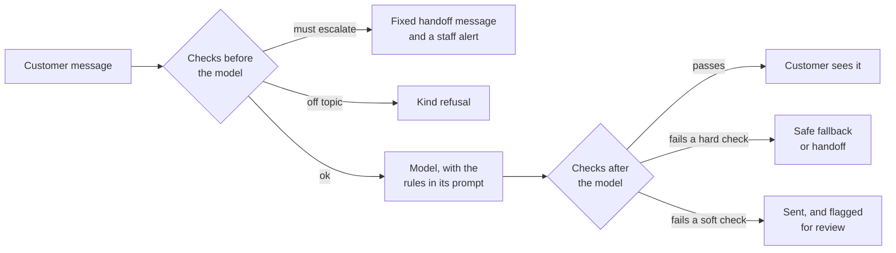

Lesson 11, Part 1 of 5 · about 10 min

# Rules in code vs rules in the prompt

**In this part,** you'll see where guardrails sit around a model, and sort the salon's five rules into the ones a prompt can handle and the ones that need code.

**Quick check before you start.** If you can answer these, skip ahead to the "Go deeper" sections.
1. Why isn't "never change prices" in the system prompt enough on its own?
2. What's the difference between a check that blocks a reply and one that only logs it?

## Why this matters

Everything in the system prompt is a request. The model usually follows it, and sometimes it doesn't. It might misread a message, get talked around by an injection, or just phrase something badly on one run out of fifty. You saw this in [Prompt injection, plainly](../10-prompt-injection/).

A guardrail is a check that doesn't depend on the model remembering its instructions. It looks at the message or the reply and decides what happens next.

For a PM, guardrails are where product rules become real. "We never quote a wrong price" is a wish until something checks every price. Deciding which rules get that treatment, and what happens when one fires, is a product call as much as an engineering one.

OWASP names this risk directly. Its entry on [Improper Output Handling (LLM05:2025)](https://genai.owasp.org/llmrisk/llm052025-improper-output-handling/) is about passing model output to other systems or people without checking it first.

## How it works

There are three places a rule can live.

1. **In the prompt.** The model reads the rule and tries to follow it. Cheap and flexible. Not reliable on its own.
2. **Before the model.** Code looks at the incoming message first. It can send a handoff, refuse, or let the message through. If it stops the message, the model never sees it, so the model can't get it wrong.
3. **After the model.** Code looks at the reply before the customer does. It can pass it, replace it with a safe fallback, or send it and flag it for a person to review.

Most good setups use all three for the rules that matter. The prompt makes good answers likely. The checks catch the ones that slip.

## Do it (step by step)

1. **List every rule your assistant has to follow.** For Polish & Co. that's the five rules in the [running example](../example/). For your own product, include rules that live in people's heads, like "we never promise a time for a callback."

   You're done when every rule is written down in one place.

2. **Ask one question of each rule.** If the model breaks it once, does it cost money, hurt someone, or create legal trouble? If yes, it needs a check in code. If it's about style or helpfulness, the prompt plus your evals is usually enough.

   Here's how the salon's rules sort out:

   | Rule | If it breaks once | Where it lives |
   |---|---|---|
   | 1. Answer only from the FAQ | A made-up answer, like parking that doesn't exist | Prompt, plus evals. Prices get a code check (rule 4). |
   | 2. Never give medical advice | Someone could get hurt | Prompt, plus a code check after the model |
   | 3. Hand off right away | Someone hurt doesn't get help | Code before the model, plus the prompt as backup |
   | 4. Never change prices or give discounts | The salon loses money, a customer feels misled | Code after the model |
   | 5. Warm and short | A clunky or cold reply | Prompt, plus a soft check that only logs |

   You're done when every rule has a "where it lives" answer, and every rule that touches money, safety or the law has at least one check in code.

3. **Decide what happens when each check fires.** There are three choices, and picking the right one matters as much as the check itself.
   - **Block and replace.** The reply never goes out. A fixed fallback or the handoff message goes instead. Use it for hard rules like prices and medical advice.
   - **Escalate.** A person gets alerted and the customer gets the handoff message. Use it for the must-escalate group.
   - **Log only.** The reply goes out, and it's flagged for someone to read later. Use it for soft rules like tone, where blocking would annoy more customers than it protects.

   You're done when every check has one of the three actions written next to it.

   

Stuck?

   - **"Everything feels important, so I want to block everything."** Every block is a customer who didn't get an answer. Part 4 shows you how to count that. Start with the two or three rules that really can't break, and log the rest.
   - **"I don't know if a rule touches the law."** Health, money, privacy and anything about who's eligible for what usually do. Ask whoever owns legal or compliance in your company. Writing the question down is already progress.
   

<strong>Go deeper (rule-based checks vs model-based checks)</strong>

Guardrails come in two flavours, and most real systems mix them.

**Rule-based checks** are plain code. Word lists, patterns (regular expressions), a lookup against the price list, a check that the output matches a strict format.
- Fast and cheap. They add almost no delay.
- Predictable. The same input always gets the same result, so they're easy to test.
- Brittle. They miss anything you didn't think of, and they flag innocent words that happen to match.

**Model-based checks** use a second AI model to judge the message or the reply. Meta's [Llama Guard](https://arxiv.org/abs/2312.06674) is a well-known example of a model trained to classify conversations as safe or unsafe against a list of categories.
- Better at meaning. They can catch "my finger looks kinda puffy" without a word list.
- Slower and more expensive, because every check is another model call.
- Less predictable. They can be wrong, and they can be targeted by injection too.

A pattern I like for safety is running both and letting either one escalate. Neither can cancel the other's escalation. If the classifier is down, the word list still runs.

## Quick check

1. Which salon rule needs a check before the model, and why?

Rule 3, hand off right away. If code catches the message first, the model never sees it, so it can't give advice or get distracted by a booking question in the same message.

2. Why is the tone rule "log only" instead of "block"?

Blocking a reply for tone means a customer gets a fallback instead of an answer. A slightly cold reply costs less than that, so it goes out and gets flagged for review.

---

**Next: [Part 2 (Checks before the model)](part-2-checks-before.md)** | [Back to the lesson](README.md)
