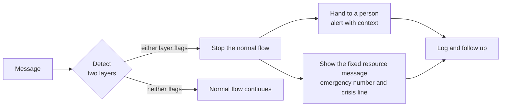

Lesson 13, Part 2 of 6 · about 15 min

# Crisis and safety protocols

**In this part,** you'll design the four steps every crisis protocol needs: detect, stop the normal flow, hand to a person, and give the right resource.

> [!IMPORTANT]
> This part describes the product pattern, not what to say to someone in crisis. The AI's job in a crisis is to get the person to a human and to the right resource quickly. It shouldn't try to counsel them. Any crisis wording your product shows should be written and signed off by qualified clinical or crisis experts.

## Why this matters

In the salon, the must-escalate group is a handful of messages. In a health, finance or insurance product, there's a wider range of moments where the normal flow has to stop:
- a medical emergency, like chest pain or trouble breathing
- someone saying they're thinking about ending their life or harming themselves, or that someone else is in danger
- someone describing abuse or being unsafe at home
- in finance or insurance, someone in severe hardship, or describing fraud happening to them right now

Each of these needs the same four steps, built so they still work when parts of your system don't.

## Do it (step by step)

6. **Define your tiers before you build anything.** Not every worrying message is an emergency. Write down at least three tiers, with plain examples for each:
   1. **Emergency.** Someone may be in immediate danger. The person needs emergency services now, and your team needs to know.
   2. **Urgent, not an emergency.** Worrying, and needs a person soon, but not a 911 call. For example, symptoms getting worse over a few days, or someone saying they're really struggling.
   3. **Normal.** The usual flow.

   The middle tier is the easy one to forget. On a health-related build, I had emergency and normal covered, and I wrote down the missing middle tier as a known gap, with the reason it wasn't built yet. Writing it down meant nobody assumed it existed.

   You're done when each tier has a definition, three or more example messages, and a named response.

7. **Detect with two independent layers.** One layer is a word and phrase list that runs on the raw message, before anything else. The other is a separate model call that only answers "does this need a person?". The rules:
   - Either layer can escalate.
   - Neither layer can cancel the other's escalation.
   - The main conversation model can't switch either one off.
   - If the model check fails or times out, the word list still runs, and the message is treated as needing review.

   That last rule is called failing closed. If your safety system breaks, it should break toward getting a person involved.

   You're done when you've tested each layer on its own, tested them together, and switched the model check off on purpose to confirm the word list still escalates.

8. **Stop the normal flow completely.** When a message escalates, the product stops doing its usual job. For an intake assistant, that means:
   - no more intake questions
   - no booking, upselling or "anything else I can help with?"
   - no model-written reply to the crisis itself

   The model is skipped for the crisis reply. That's the same pattern as the salon's handoff in [Guardrails, Part 2](../11-guardrails/part-2-checks-before.md), with higher stakes.

   You're done when an escalated message produces only the fixed resource message and the handoff, and your tests confirm no other tool or question fires.

9. **Hand to a person, with context and a clock.** A handoff is only real if someone picks it up. Write down:
   - **Who.** A named role, like the on-call clinician or the hardship team, not a shared inbox.
   - **How fast.** A target pickup time for each tier.
   - **What they see.** The person's own words, the tier, which layer flagged it, and the time. Show the original message, not only a model's summary of it.
   - **Out of hours.** What happens at 3am on a Sunday, and what the person is told.

   Then test it end to end, the way you did in [Guardrails, Part 4](../11-guardrails/part-4-escalate-refuse-log.md). Send a test message and confirm the alert reached a real person in the right place.

   You're done when every tier has a who, a how fast, and an out-of-hours plan, and you've tested the alert end to end.

10. **Give the right resource, in fixed, approved words.** The person should see a short message right away, so they're never left waiting with nothing. It should:
    - say that a person is being told, and roughly when they'll hear back
    - give the emergency number for where they are
    - give a crisis line where it applies. In Canada, [9-8-8](https://988.ca/about) is the Suicide Crisis Helpline, by call or text, any time. In the US, the [988 Suicide & Crisis Lifeline](https://988lifeline.org/) is also call or text 988.
    - stay on screen, rather than being replaced by the next message

    This message is fixed text, not generated. It's written with your clinical or crisis experts, checked against recognised safe messaging guidance, signed off by a named person, and versioned so you know which wording was live on which day. If you serve people in more than one country, the resources have to match each place.

    You're done when the resource message is written, signed off, versioned, and shows the right resources for every place you serve.

<strong>Go deeper (why the crisis reply shouldn't come from the model)</strong>

It can feel kinder to let the model write something personal. But a generated reply can:
- miss the resource, or give the wrong number for the person's location
- say something well-meaning that experts would never say to someone in crisis
- keep the conversation going in the model's usual style, as if nothing happened
- vary from run to run, so you can't fully test it

A fixed message can be reviewed by experts once, tested every time, and changed on purpose. It's the same reason the salon's handoff message is fixed text. The care in a crisis comes from the human who picks up, quickly. The product's job is to make that happen.

<strong>Go deeper (testing a crisis protocol)</strong>

Your crisis tests need to cover more than detection:
- **Detection.** Clear crisis messages, indirect ones, ones buried inside a normal answer, and ones in every language you support. All must-pass, five runs each.
- **False alarms.** Idioms and everyday phrases that sound alarming and aren't.
- **Flow.** After escalation, no other question, tool or upsell fires.
- **Handoff.** The alert reaches the right person with the original message.
- **Failure.** The model check is switched off and the word list still escalates.
- **Resource.** The right numbers show for each location.

Write these test messages carefully. Keep them short and plain, store them with access controls, and make sure everyone on the team knows the set exists and what's in it.

## Quick check

1. What are the four steps of a crisis protocol?

Detect, stop the normal flow, hand to a person, and give the right resource.

2. The model check times out on a message the word list didn't flag. What should happen?

Fail closed. Treat the message as needing review by a person, rather than letting it through the normal flow unchecked.

3. Why is the resource message fixed text?

So experts can review it once, it can be tested every time, and it never varies, misses the resource, or says something unsafe.

---

**Next: [Part 3 (Hard rules, model judgment and the never list)](part-3-hard-rules-never-list.md)** | [Back to the lesson](README.md)
